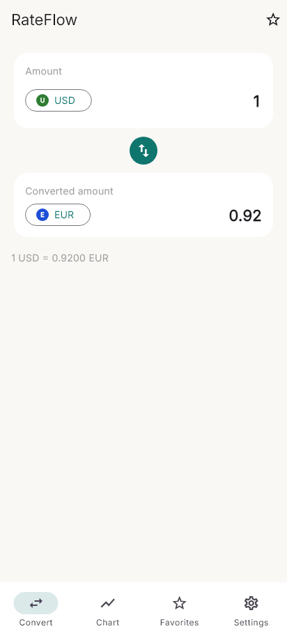
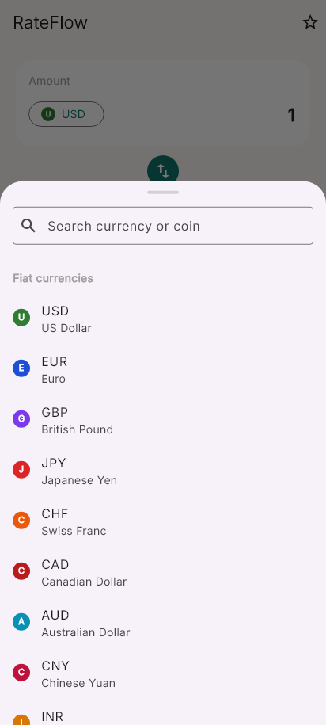
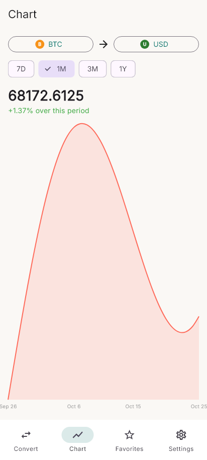
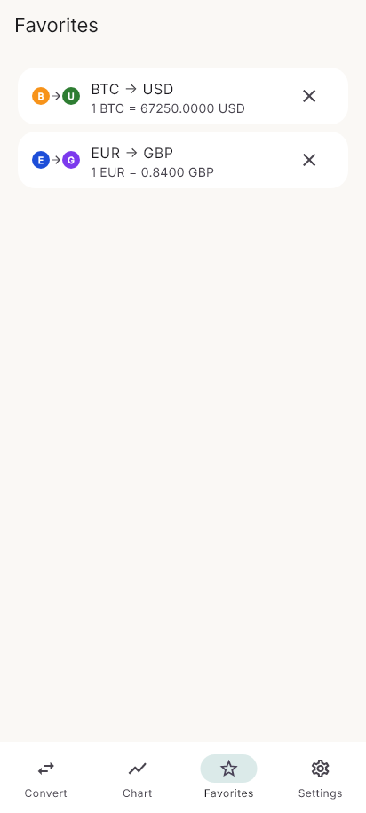
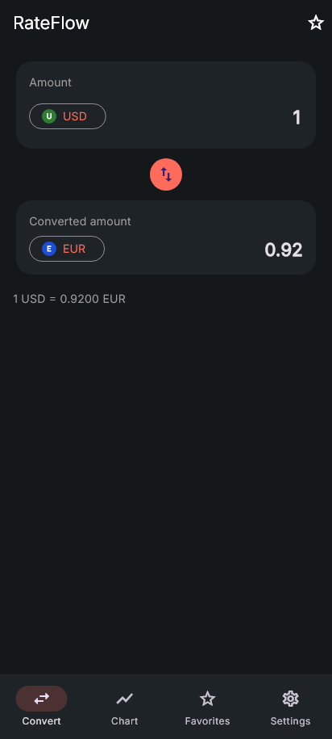

# RateFlow

A real-time currency converter for fiat money and crypto, built with Flutter.

Pick any two currencies - say USD and BTC - and get a live conversion, a historical rate chart, and the option to save the pair as a favorite for quick access later.

## Screenshots

| Convert | Currency picker |
|:---:|:---:|
|  |  |
| **Chart** | **Favorites** |
|  |  |

<p align="center">
  <br/>
  <b>Dark mode</b>
</p>

## Why I built it

I wanted a currency converter that didn't treat crypto as an afterthought - most apps are either "fiat only" or "crypto only", and I wanted one screen that handles both. It was also a good excuse to get comfortable combining two different public APIs behind one simple interface, and to practice a design that doesn't lean on any UI kit or template.

## Features

- **Live conversion** between 12 fiat currencies and 8 cryptocurrencies, in any direction (fiat → fiat, fiat → crypto, crypto → fiat, crypto → crypto).
- **Historical rate chart** with a 7D / 1M / 3M / 1Y toggle, showing the % change over the selected period.
- **Favorites** - star a pair on the Convert screen, see it with its live rate on the Favorites tab, tap it to reload that pair.
- **Light and dark mode**, toggled from Settings and remembered between launches.
- **Offline fallback** - if a rate can't be fetched, the last successful rate is shown instead, with a note that it's cached.
- Currency picker with search, and colour-coded badges instead of flag emoji (which don't render consistently on every platform).

## How it works

The app has one small provider per concern, wired up with `provider`:

- **`ConverterProvider`** holds the selected currencies, the typed amount and the result. Calling `convert()` asks `RateService` for a rate, multiplies it by the amount, and caches the rate on success (or falls back to the cache on failure).
- **`RateService`** decides which API to call based on whether each side of the pair is fiat or crypto:
  - fiat → fiat: one call to [frankfurter.app](https://frankfurter.app) (free, built on ECB reference rates).
  - crypto → fiat, or fiat → crypto (inverted): one call to the [CoinGecko](https://www.coingecko.com/) free API.
  - crypto → crypto: two CoinGecko calls priced in USD, then crossed.
- **`FavoritesProvider`** keeps a list of saved pairs in `shared_preferences`, as JSON.
- **`ThemeProvider`** and **`NavProvider`** are small `ChangeNotifier`s for the light/dark switch and the bottom-nav tab, so any screen can read or change them through `context.watch` / `context.read`.

The chart pulls daily history for the same pair logic as above (crypto-to-crypto charting is intentionally left out - it would need two history calls crossed through USD, which felt like a lot of complexity for a pairing people rarely chart).

## Project structure

```
lib/
├── main.dart                  # MultiProvider + MaterialApp setup
├── models/                    # Currency, FavoritePair, ChartPoint
├── providers/                 # ConverterProvider, FavoritesProvider, ThemeProvider, NavProvider
├── services/                  # FiatApi, CryptoApi, RateService, RateCache
├── screens/                   # HomeShell (bottom nav) + the 4 tabs
├── widgets/                   # CurrencyBadge, currency picker bottom sheet
├── theme/                     # colors + light/dark ThemeData
└── utils/                     # the fiat & crypto currency lists
```

It's a flat structure on purpose - no separate data/domain/presentation layers. For an app this size, a provider calling a service directly is easy to follow and easy to change.

## Tech stack

| What | Package |
|---|---|
| State management | [provider](https://pub.dev/packages/provider) |
| Networking | [http](https://pub.dev/packages/http) |
| Charts | [fl_chart](https://pub.dev/packages/fl_chart) |
| Storage | [shared_preferences](https://pub.dev/packages/shared_preferences) |
| Dates / numbers | [intl](https://pub.dev/packages/intl) |
| Font | Inter (bundled in `assets/fonts`) |
| APIs | [frankfurter.app](https://frankfurter.app) (fiat), [CoinGecko](https://www.coingecko.com/en/api) (crypto) |

## Run it

You need Flutter 3.38 or newer.

```bash
git clone https://github.com/sirine2907/RateFlow.git
cd RateFlow
flutter pub get

flutter run -d windows     # or macos / linux
flutter run -d android     # phone or emulator
```

To build a release for Windows:

```bash
flutter build windows --release
```

## Tests

```bash
flutter test
```

The screenshots above come from golden tests that render each screen with a fake rate service (so they don't depend on a live network call or real exchange rates). To update them:

```bash
flutter test test/screenshots --update-goldens
```

## License

MIT, see [LICENSE](LICENSE).
